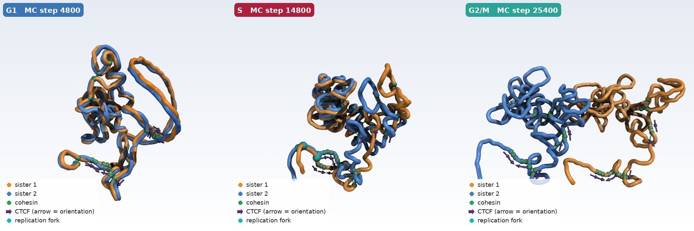

<p align="center"></p>

<p align="center">
<a href="https://www.python.org/"></a>
<a href="https://openmm.org/"></a>
<a href="https://numpy.org/"></a>
<a href="https://numba.pydata.org/"></a>
<a href="https://scipy.org/"></a>
<a href="https://matplotlib.org/"></a>
<a href="https://pyvista.org/"></a>
<a href="https://docs.pytest.org/"></a>
<a href="https://github.com/SFGLab/RepliSage/blob/main/LICENSE"></a>
</p>

<p align="center"></p>
<p align="center"><sub>One simulated cell cycle: G1, S (replication forks, sisters appear) and G2/M. Sister chromatids in orange and blue, cohesin in green, CTCF orientation as purple arrows, forks in turquoise.</sub></p>

RepliSage simulates how loop extrusion, epigenetic state and DNA replication shape chromatin in 3D, from G1 through S phase to G2/M. It runs a replication simulation, a Monte Carlo of loop-extruding factors (LEFs) and Potts spins (A/B compartments), and optionally 3D structures with OpenMM. Every run ends with a single `report.html`.

## Install

Python 3.10 or newer.

```bash
git clone https://github.com/SFGLab/RepliSage && cd RepliSage
pip install -r requirements.txt      # or: pip install .   (gives the `replisage` command)
```

The 3D part (OpenMM) is faster on a GPU; the Monte Carlo runs on CPU. A Docker image is provided (`Dockerfile`).

## Run

The everyday choices are command-line flags (`-h` lists them all):

```bash
# loop extrusion only
python src/run.py --bedpe-file loops.bedpe --region chr14:80835000-98674700

# add replication timing (bigWig, txt, parquet, or `builtin`), then decide about 3D
python src/run.py --bedpe-file loops.bedpe --region chr14:80835000-98674700 --rt-file timing.bigWig --run-md true

# replication stress, several replicas
python src/run.py -c my_config.ini --with-stress --n-replicas 4 --threads 4
```

| Flag | Meaning |
|---|---|
| `-c FILE` | Read a config file |
| `--bedpe-file FILE` | CTCF input: loops (BEDPE) or peaks (BED, narrowPeak) |
| `--motif-genome FASTA` | Read CTCF orientation from motifs when the input has none |
| `--hic FILE` | Validate the model against a Hi-C map (`.hic`) |
| `--rt-file FILE` | Replication timing. No file: no replication simulation, no forks |
| `--region CHR:START-END` | Region to model |
| `--run-md true/false` | Build 3D structures (needs replication data or not, both work) |
| `--with-stress` | Replication stress (off by default) |
| `--n-replicas`, `--seed`, `--out`, `--name`, `--platform`, `--threads` | Run control |

Everything else (Monte Carlo, replication and MD energies, force field, plots) is set **only in the config file**: copy `src/config.ini` or one of the annotated files in [`examples/`](https://github.com/SFGLab/RepliSage/tree/main/examples) and run it with `-c`. Flags win over the file; the file wins over the defaults.

More in the [documentation](https://sfglab.github.io/RepliSage/): [command line](https://sfglab.github.io/RepliSage/cli/), [pipeline](https://sfglab.github.io/RepliSage/pipeline/), [replication](https://sfglab.github.io/RepliSage/replication_model/), [Monte Carlo](https://sfglab.github.io/RepliSage/mc_model/) and [3D](https://sfglab.github.io/RepliSage/md_model/) models, [config](https://sfglab.github.io/RepliSage/config/), [analysis](https://sfglab.github.io/RepliSage/analysis/).

## Output

Each run creates a folder `results/<run_name>/` (one `replica_XX/` per replica) containing:

| File | What |
|---|---|
| `report.html` | Start here: model, figures, diagnostics, command and all parameters |
| `viewer_3d.html` | Interactive 3D viewer: trajectory bar, cell-cycle phase, colour modes (sister chromatids, compartments, rainbow, replication) and a moving-window contact map with LEFs and forks marked |
| `movie_3d.mp4`, `movie_3d.gif` | Interpolated PyVista movie |
| `ensemble/*.cif` | One mmCIF per structure (chains A and B = sister chromatids); open in ChimeraX with `view.cxc` |
| `plots/`, `metadata/` | Figures (png + svg) and raw arrays / CSV statistics |
| `config_used.ini` | Exact configuration, re-run with `-c` |

Switch parts off with `--no-report` and `--no-viewer`. The 3D movies take minutes to render: add `--skip-movies` for quick runs.

## Configuration

`src/config.ini` documents every parameter. Precedence: defaults < config file < command-line flags.

## Tests

```bash
pip install -e ".[test]" && pytest            # add -m "not slow" to skip OpenMM / full-pipeline tests
```

## Citation

* Korsak, S. et al. "RepliSage: a stochastic graph-based framework for 3D chromatin modeling across the cell cycle." Nucleic Acids Research 54.12 (2026): gkag618.
* Buka, K. et al. "Improved cohesin HiChIP protocol and bioinformatic analysis for robust detection of chromatin loops and stripes." Communications Biology 8.1 (2025): 437.
* Massey, D. J. and Koren, A. "High-throughput analysis of single human cells reveals the complex nature of DNA replication timing control." Nature Communications 13 (2022): 2402.
