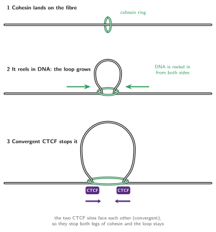
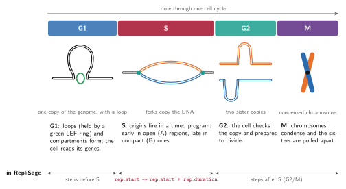
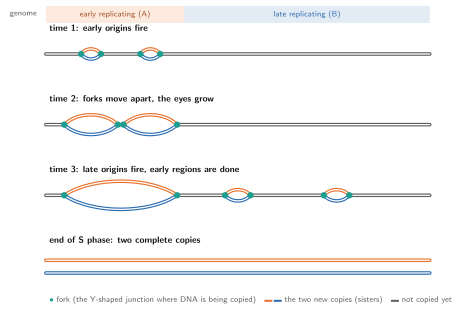
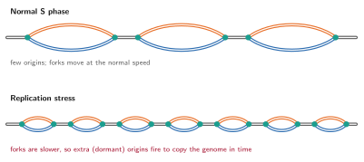
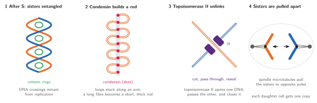
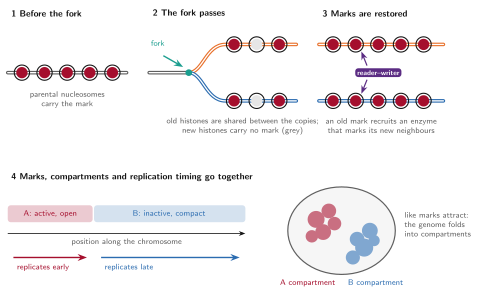

# Biological background

This page explains, from scratch, the biology behind RepliSage. You do not need to know any of it beforehand. At the end of every topic there is a short note on **how RepliSage models it**, and a table at the bottom of the page collects these notes.

## The genome is folded

A human cell holds about two metres of DNA inside a nucleus a few micrometres wide. The DNA is wrapped around proteins called **histones** (the DNA with its histones is called **chromatin**) and then folded in space in a regular way. Two features of this folding matter here:

* **Loops** bring two distant places on the same chromosome next to each other. Many loops are made by *loop extrusion*, explained next.
* **Compartments** are the large-scale split of the chromosome into two spatial neighbourhoods: **A** (active, open chromatin with many expressed genes) and **B** (inactive, compact chromatin). Regions of the same kind attract each other and cluster in space, like oil droplets merging in water.

These structures are measured with **Hi-C**, an experiment that counts how often two places of the genome touch. A Hi-C map shows loops as dots and compartments as a checkerboard.

## Loop extrusion

**Loop extrusion** is the process that makes most loops. A ring-shaped protein complex, **cohesin**, lands on the DNA fibre so that the fibre passes *through* its ring (the ring encircles the DNA, it never sits beside it). It then pulls the fibre through from both sides, so the loop between the two contact points grows and cohesin stays at the base of the loop, with both stems of the loop threaded through the ring. Proteins that extrude loops are generally called **LEFs** (loop extruding factors).

Extrusion does not run forever. The protein **CTCF** sits on the DNA at specific sites and has a direction (an *orientation*). A CTCF site stops cohesin when it is approached from one particular side. If two CTCF sites face each other (**convergent** orientation), they stop the two legs of cohesin from both sides and the loop becomes stable, with the two sites held together at its base. This is why many Hi-C loops are anchored at convergent CTCF pairs.

Loops keep forming and dissolving: cohesin comes off after a while and new ones load, so a Hi-C map is an average over a dynamic population of loops.

!!! note "In RepliSage"
    Each LEF is a pair of legs $(m_i, n_i)$ on two beads of the chain. Legs slide, load and unload in the Monte Carlo moves. CTCF sites come from your BEDPE file together with their orientation, and attract the legs: a forward-facing site attracts a left leg, a reverse-facing site a right leg, so convergent pairs make the deepest wells. See the [Monte Carlo model](mc_model.md) and [pre-processing](preproc.md).

## The cell cycle

Before a cell divides it must copy its DNA and then split the copies equally. This happens in an ordered sequence of phases called the **cell cycle**:

* **G1**: the cell grows and reads its genes. The genome has one copy; loops and compartments are in place.
* **S phase** (synthesis): the DNA is **replicated**, that is, copied. This is the phase RepliSage focuses on.
* **G2**: the cell checks the copy and prepares to divide.
* **M phase** (mitosis): the chromosomes condense into compact rods and the two copies are pulled into the two daughter cells.

G2 and M are modelled together as **G2/M**.

### S phase and the replication program

DNA copying starts at thousands of places called **replication origins**. At an origin two **replication forks** are built that move away from each other in opposite directions, unwinding the DNA and copying it. Where two forks from neighbouring origins meet, they merge and stop. The two new copies of a chromosome are called **sister chromatids**. For a while they are glued together by cohesin (a different pool of cohesin from the one extruding loops): a ring that encircles both sister DNA molecules at once, so that they can be separated cleanly later.

Origins do not fire all at once. The cell follows a **replication program**: some regions are copied early in S phase and others late. The program is strongly linked to chromatin state: **open, active (A) regions replicate early, and compact, inactive (B) regions replicate late**. The moment at which a region is copied is called its **replication timing**. It is measured genome-wide, and it is the main input that RepliSage uses to decide where and when forks move.

Forks are not simple passers-by. They can meet loop extruders, push them, or act as barriers for them; the chromatin behind a fork also has to be rebuilt (see the section on epigenetic marks below).

!!! note "In RepliSage"
    The program is simulated by **Replikator**, which turns a replication timing profile into a matrix that says, for every bead and every moment, whether it is already copied. Early beads fire first, forks travel at a fork speed, and the time axis is normalised so that S phase starts with the first fired origin and ends exactly when the last locus is replicated. In the Monte Carlo, a fork is a moving barrier for loops; in the 3D model, copied beads get a second chain, the sister chromatid. See the [replication model](replication_model.md).

### Replication stress

Replication stress is anything that makes copying harder or slower: shortage of building blocks, DNA damage, collisions with transcription, or tightly packed chromatin. The result is that forks **slow down or stall**. The cell reacts by firing extra, normally unused (**dormant**) origins, so that the genome is still copied in time. Unrepaired stress can leave regions under-replicated and is linked to genome instability and cancer.

!!! note "In RepliSage"
    `--with-stress` (`REP_WITH_STRESS`) is a simple version of this: slower forks (`REP_SPEED_SCALE = 1`), more origins (`REP_INIT_RATE_SCALE = 2`) and a wider spread of firing times (`REP_T_STD_FACTOR = 0.2`). Fork stalling, restart and the damage response are not modelled; see [known limitations](limitations.md).

### Mitosis: condensins, topoisomerase and separation of the sisters

After S phase the sisters sit side by side, still held by cohesin, and their DNA is **entangled** (two DNA molecules copied next to each other end up wound around each other, like twisted cables). To divide, the cell must compact the chromosomes and untangle the copies. Three actors do this:

* **Condensins** are ring-like motors related to cohesin. They also extrude loops, but they do it in mitosis, make much bigger loops and nest them along a central axis. This turns a long fibre into a short, thick **mitotic chromosome**, and also pushes entanglements out of the chromatid.
* **Topoisomerase II** is an enzyme that cuts one DNA double helix, passes another double helix through the gap and seals it again. This resolves the crossings between sisters (it *decatenates* them). Condensin and topoisomerase II work together: condensin compaction biases the strand passage so that the sisters become separate.
* **Spindle microtubules** attach to the chromosomes and pull the two sisters to opposite poles, after the remaining cohesin is removed.

!!! note "In RepliSage"
    Condensin is a **second LEF family** (`N_LEF2`) in the Monte Carlo, which acts mostly after S phase, with larger loops. In the 3D model topoisomerase is represented by randomly switching off the excluded volume of some beads so that chains can pass through each other, and the spindle by a constant pulling force that separates the two chains after S phase. Both are deliberately simple stand-ins; see the [3D model](md_model.md) and [limitations](limitations.md).

## Epigenetic marks, replication and compartments

**Epigenetic marks** are chemical tags on histones (for example methylation or acetylation) and on the DNA itself. They do not change the DNA sequence, but they say whether a region is open and active or compact and silent, and they are the molecular basis of the A and B compartments. Because marks of the same kind attract each other, they drive the folding of the genome into compartments.

Replication is a challenge for marks. When the fork passes, the old (**parental**) histones, carrying the marks, are split between the two new copies, and **new histones**, without marks, fill the gaps. So right behind the fork each copy has only about half of its marks. The cell restores them by **mark propagation**: *reader–writer* enzymes recognise a mark on a nearby old histone and write the same mark on the new neighbouring histones. In this way the pattern is copied to both sisters, usually within the cell cycle. The more repressive, late-replicating domains tend to need more time to be restored, which links marks to the replication program.

Marks, compartments and replication timing are therefore tied together: A regions carry active marks and replicate early; B regions carry repressive marks and replicate late; and the passage of the fork is the moment at which marks are diluted and then re-established.

!!! note "In RepliSage"
    Every bead has one of **five epigenetic states** $s_k \in \{-2,-1,0,1,2\}$: positive states are A-like (active) and negative states are B-like (inactive). The epigenetic energy favours states that agree with the replication timing field (early replicating beads go to A, late ones to B), and neighbouring beads, and the two anchors of a loop, prefer the same state, which produces compartments. When a fork passes a bead, the bead receives a one-off push to the state expected from its timing, a simple model of re-establishing marks (the *fork as epigenetic organiser*, `REP_FORK_EPIGENETIC_ORGANIZER`). The five states are abstract and do not correspond to specific marks. See the [Monte Carlo model](mc_model.md).

## How the pieces are modelled

| Biology | In RepliSage | Where |
|---|---|---|
| Loop extrusion by cohesin | LEFs with two legs that slide, load and unload on the bead chain | [Monte Carlo model](mc_model.md) |
| CTCF sites and orientation | Binding potentials $L(k)$ (forward site, left leg) and $R(k)$ (reverse site, right leg) from the BEDPE file | [Pre-processing](preproc.md) |
| Cell cycle G1, S, G2/M | Ranges of Monte Carlo steps: before `REP_START_TIME`, during `REP_TIME_DURATION`, after | [Monte Carlo model](mc_model.md) |
| Origins, forks, replication timing | Replikator simulation from a timing profile; a matrix of copied beads over time | [Replication model](replication_model.md) |
| Replication stress | Slower forks, more origins (`--with-stress`) | [Replication model](replication_model.md) |
| Sister chromatids | A second chain in the 3D model for every copied bead, tied to the first | [3D model](md_model.md) |
| Condensin | Second LEF family (`N_LEF2`) | [Monte Carlo model](mc_model.md) |
| Topoisomerase II | Random removal of excluded volume | [3D model](md_model.md) |
| Spindle pulling | Constant force that separates the sisters after S phase | [3D model](md_model.md) |
| Epigenetic marks and compartments | Five epigenetic states per bead, coupled to timing, to neighbours and to loop anchors | [Monte Carlo model](mc_model.md) |
| Mark restoration after the fork | Fork as epigenetic organiser | [Monte Carlo model](mc_model.md) |

Every one of these is a simplification. In particular, loop extrusion and the epigenetic states are treated identically in both sister chromatids (see [known limitations](limitations.md)). Read the limitations before drawing biological conclusions.
