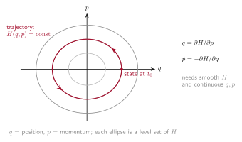
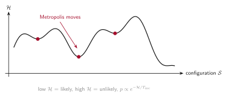
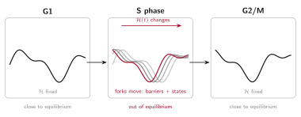

# The Hamiltonian idea, and where RepliSage departs from it

RepliSage is written in the language of a **Hamiltonian** $\mathcal{H}$, but it is not a Hamiltonian in the strict sense. This page explains what the word means, what we borrow from it, and what we deliberately give up. It is worth reading once, because it tells you how far the results can be pushed.

## In analytical mechanics

In classical mechanics, a system with $n$ degrees of freedom is described by positions $q = (q_1, \dots, q_n)$ and their conjugate momenta $p = (p_1, \dots, p_n)$. The pair $(q, p)$ is a point in **phase space**, a space with $2n$ dimensions, and the whole state of the system at one moment is one point in it.

The **Hamiltonian** $H(q, p)$ is a function on phase space, usually the total energy (kinetic plus potential). It determines the motion through Hamilton's equations:

$$\frac{dq_j}{dt} = \frac{\partial H}{\partial p_j}, \qquad \frac{dp_j}{dt} = -\frac{\partial H}{\partial q_j}$$

Two things are worth noticing. First, the formalism relies only on theory and on the variables $q$ and $p$: given $H$, the future follows. Second, it needs **derivatives**, so $H$ must be smooth and the variables continuous. If $H$ does not depend on time, energy is conserved.

## In statistical mechanics

With a huge number of particles we cannot follow every trajectory, so statistical mechanics asks a different question: how likely is each state? For a system in equilibrium with a heat bath at temperature $T$, the answer is the Boltzmann distribution,

$$p(\mathcal{S}) = \frac{1}{\mathcal{Z}} \exp\left(-\frac{\mathcal{H}}{k T}\right)$$

where $\mathcal{S}$ is a state, $\mathcal{Z}$ is the normalisation (partition function) and $k$ is the Boltzmann constant. Here the Hamiltonian is only an **energy function**: you do not integrate any equations of motion, you only compare energies, and a Monte Carlo method such as Metropolis samples the distribution.

This formulation is elegant, but it can break down in practice. Realistic systems have **non-linear** interactions and **very many degrees of freedom**, so the energy landscape is rugged, exact solutions are out of reach, and equilibrium may not be reached at all.

## What RepliSage borrows

RepliSage is an effort to use a **pseudo-Hamiltonian** formalism, in the spirit of statistical physics. We write one energy function,

$$\mathcal{H} = \mathcal{H}_{\text{le}} + \mathcal{H}_{\text{rep}} + \mathcal{H}_{\text{epi}}$$

over the configuration $\mathcal{S}$ (loop positions $(m_i, n_i)$ and epigenetic states $s_k$), and sample $p(\mathcal{S}) \propto e^{-\mathcal{H}/T_{\text{mc}}}$ with Metropolis Monte Carlo. This gives a transparent way to say what the model likes (long loops, legs on CTCF sites, no crossing, no loops across forks, similar neighbouring states), and to explore many configurations, with the full Hamiltonian machinery left aside.

## Why it is not a real Hamiltonian

There are three reasons, best stated plainly.

**1. It is not defined on a phase space.** There are no momenta, and the variables are discrete (bead indices and five spin states), so there are no derivatives and no equations of motion. $T_{\text{mc}}$ is a modelling parameter and not a physical temperature, and Monte Carlo steps are pseudotime. The 3D part is an ordinary molecular dynamics simulation, but its forces are built from the Monte Carlo output.

**2. It is out of equilibrium, especially in S phase.** The Boltzmann distribution assumes a fixed energy function and enough time to settle. In RepliSage the energy changes with time, $\mathcal{H}(t)$, because replication forks move:

* loop extrusion **barriers change**, since $f_{\text{rep}}(x,t)$ decides which loops are allowed, and forks push loops ahead of them;
* **epigenetic states respond**, since the field $h_{t,k}$ shifts the preferred state of a bead when a fork passes, and the states can reorganise collectively, like a phase transition in a Potts-like model.

Both effects are seen in cells: replisomes push cohesin along DNA, and B to A compartment switching has been observed in S phase and under replication stress. So during S phase the system is chasing a moving target and is never in equilibrium. G1 and G2/M are much closer to the equilibrium picture, because the rules stop changing.

**3. The energy is largely data-driven.** In the Monte Carlo, the binding potentials $L$ and $R$ come from your BEDPE file, the epigenetic field $h_k$ comes from replication timing, and the forks come from the Replikator simulation. The coefficients are balanced so that the terms are comparable, not derived from first principles. In the 3D model, force constants and ties between sister chromatids also depend on the data and on the replication state. Think of the energy as a compact way to encode experimental knowledge and hypotheses, not as a law of nature.

## How to read results

Use the Hamiltonian as a **language for hypotheses**: each term says what we assumed, and you can change it. Trust trends (for example, loops getting shorter in S phase) more than exact values, and remember that in S phase the sampled states are a response to the forks and not an equilibrium ensemble. See also [Known limitations](limitations.md) and the notation in the [Monte Carlo model](mc_model.md).
