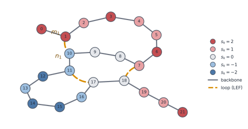
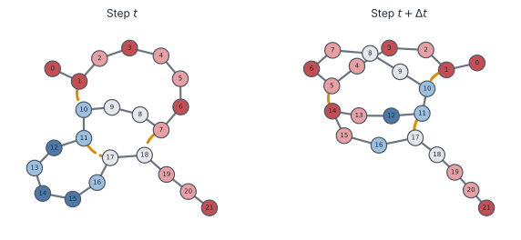

# The idea in a nutshell

RepliSage asks one question: *what does the 3D shape of a chromosome look like when loop extrusion, epigenetic states and DNA replication all influence each other, from G1 to G2/M?* This page gives the intuition; the [Monte Carlo model](mc_model.md) page has the same story with the paper's formulas.

## Beads, loops and states

The DNA is cut into $N_{\text{beads}}$ pieces (beads) joined like a necklace. This necklace is a graph $\mathcal{G}$ with two extra ingredients:

* **Loops.** A loop extruding factor (LEF, such as cohesin) is a ring that reels in DNA from both sides. LEF $i$ is described by the beads $(m_i, n_i)$ its two legs stand on. LEFs prefer large loops, stop at CTCF sites and avoid crossing each other. This part comes from [LoopSage](https://github.com/SFGLab/pyLoopSage).
* **Epigenetic states.** Each bead $k$ has a label $s_k \in \{-2,-1,0,1,2\}$ (five states). Beads linked along the chain or by a loop like to share a label, and replication timing biases the label: early replicating DNA goes towards positive labels (A), late towards negative (B). Compartments are the **macrostate** that emerges when many beads agree.

A tiny example (22 beads, drawn with the Kamada-Kawai layout, which places linked nodes close together) shows how the pieces fit:

Grey lines are the **backbone**, dashed orange lines are **loops** (the legs $m_i, n_i$ of a LEF stand on the two joined beads), and colours are the **states** $s_k$ (red for A-like, blue for B-like). Loops pull distant beads together, and same-coloured beads that sit close form compartment-like domains.

## A co-evolving graph

The graph is not fixed. Its **edges** (loops) and its **node labels** (states) change together, and each one steers the other. Networks of this kind are called *co-evolutionary* or *adaptive* networks.

In the snapshots above a LEF moves from beads (7, 18) to beads (5, 14). That brings red bead 5 next to bead 14, which was blue, and bead 14 turns red. The new contact then reshapes the layout, so the next loop move sees a different neighbourhood.

* **States shape loops.** Loops that join beads of similar states are favoured through the binding and crossing terms of the energy.
* **Loops shape states.** Beads linked by a loop prefer the same label, so a new loop can pull a bead into a neighbouring domain.
* **Replication joins in.** Forks add a third influence: they move through the graph, push LEFs and bias the labels they pass.

Monte Carlo updates both parts of the graph in turn, and the 3D model is built from every snapshot.

## Replication: a slow barrier

A fork creeps along DNA while cohesin comes and goes within about 15 to 30 minutes, and S phase lasts around 8 hours. For a LEF, a fork is therefore a **slow moving barrier** that pushes it along. The model keeps one minimal rule: a loop should not straddle a fork. Its strength $c_{\text{rep}}$ goes from a solid wall to a permeable one. Forks can also give passing beads a push in their epigenetic field (the *organiser* effect, optional).

## Temperature and sampling

(For what "energy" means and why it is only a pseudo-Hamiltonian, see [the Hamiltonian idea](hamiltonian.md).) The model defines an energy $\mathcal{H}$ and samples states with the Metropolis rule: a random change is accepted if it lowers $\mathcal{H}$, or with probability $e^{-\Delta\mathcal{H}/T_{\text{mc}}}$ otherwise. $T_{\text{mc}}$ is how noisy the sampling is. It is a modelling knob and is not the 310 K of the 3D simulation. The output is an **ensemble** of states, and one Monte Carlo step is **pseudotime**, not seconds. During S phase forks keep changing the energy, so the system is out of equilibrium. There is no simulated annealing: $T_{\text{mc}}$ stays fixed through G1, S and G2/M, and it is set in the critical region, where loops move freely but do not stack (see [the Hamiltonian idea](hamiltonian.md#temperature-in-replisage)).

## From graph to 3D

Each sampled graph becomes springs and forces in OpenMM: loops are springs, same-state beads attract, and with replication there are two chains (sister chromatids) tied together where DNA is copied. See the [molecular dynamics model](md_model.md).

