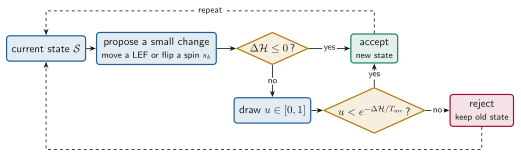
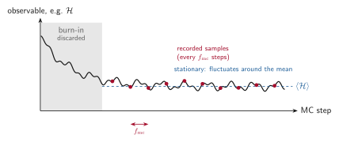
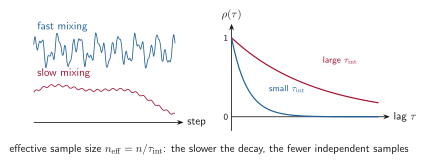
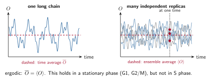

# Monte Carlo, MCMC and Metropolis

RepliSage explores its configurations with a **Markov chain Monte Carlo** (MCMC) method. This page explains the words, and how to tell whether a chain can be trusted. The [Monte Carlo model](mc_model.md) page gives the details of the RepliSage moves, and the [Analysis](analysis.md) page lists the diagnostics that the report computes.

## Key terms at a glance

| Term | Short definition |
|---|---|
| Monte Carlo simulation | Estimating an average from random samples instead of summing over all states |
| Markov chain | A sequence of states in which the next state depends only on the current one |
| MCMC | A Markov chain built so that, in the long run, states appear with the target probability $p(\mathcal{S}) \propto e^{-\mathcal{H}/T_{\text{mc}}}$ |
| Metropolis rule | Accept a proposed change with probability $\min(1, e^{-\Delta\mathcal{H}/T_{\text{mc}}})$, otherwise keep the old state |
| Proposal | One attempted change of the configuration: a LEF move or a spin flip |
| Sweep (`N_SWEEP`) | The number of proposals made in one Monte Carlo step |
| Monte Carlo step | One unit of simulated (pseudo)time: `N_SWEEP` proposals in a row |
| Sampling step (`MC_STEP`) | A configuration is saved every `MC_STEP` Monte Carlo steps. Saved configurations are the recorded samples that all statistics and 3D structures use |
| Detailed balance | For any two configurations $\mathcal{S}_a$ and $\mathcal{S}_b$ (here $a$ and $b$ just label states, they are unrelated to compartments A and B), the probability to be in $\mathcal{S}_a$ and move to $\mathcal{S}_b$ equals the probability to be in $\mathcal{S}_b$ and move to $\mathcal{S}_a$: $p(\mathcal{S}_a)\,P(\mathcal{S}_a \to \mathcal{S}_b) = p(\mathcal{S}_b)\,P(\mathcal{S}_b \to \mathcal{S}_a)$. It guarantees that $p$ is the stationary distribution of the chain |
| Burn-in | The first `BURNIN` Monte Carlo steps of a run, which are discarded because the chain still remembers its arbitrary starting configuration and has not yet reached typical states |
| Stationary | The statistics of the chain no longer change in time (true in G1 after burn-in, not in S phase) |
| Autocorrelation | How strongly a value at step $t$ is related to the value at step $t+\tau$ |
| Mixing | How fast the chain forgets where it was; slow mixing means large autocorrelation |
| Ergodic mean | The time average of one long chain, which equals the ensemble average when the chain is ergodic |

## Monte Carlo simulation

A **Monte Carlo simulation** estimates an average by random sampling. We want the expected value of an observable $O$ (say, the mean loop length) over a probability distribution $p(\mathcal{S})$ of states $\mathcal{S}$,

$$\langle O \rangle = \sum_{\mathcal{S}} O(\mathcal{S})\, p(\mathcal{S})$$

The sum is over astronomically many states, so we cannot do it exactly. Instead we draw $n$ states $\mathcal{S}_1, \dots, \mathcal{S}_n$ from $p$ and use the sample mean, which converges to $\langle O \rangle$ when $n$ is large.

## Markov chains and MCMC

The difficulty is how to draw samples from $p(\mathcal{S}) \propto e^{-\mathcal{H}/T_{\text{mc}}}$ when we do not know the normalisation $\mathcal{Z}$. MCMC builds a **Markov chain**, a sequence of states in which each state depends only on the previous one, designed so that in the long run the chain visits each state with probability $p(\mathcal{S})$. The samples are not independent, but they have the right distribution.

## The Metropolis algorithm

The **Metropolis algorithm** is the recipe RepliSage uses. Starting from the current state, it proposes a small random change (move a LEF, or flip a spin $s_k$) and accepts it with probability

$$P_{\text{accept}} = \min\left(1,\ e^{-\Delta\mathcal{H}/T_{\text{mc}}}\right)$$

Downhill moves are always accepted, uphill moves sometimes. Because only the energy *difference* appears, $\mathcal{Z}$ is never needed. If a move is rejected, the old state is counted again.

The rule satisfies **detailed balance**. Take two configurations $\mathcal{S}_a$ and $\mathcal{S}_b$ (the letters only label the states, they are not compartments). In equilibrium, the chance of being in $\mathcal{S}_a$ and jumping to $\mathcal{S}_b$ equals the chance of being in $\mathcal{S}_b$ and jumping back:

$$p(\mathcal{S}_a)\,P(\mathcal{S}_a \to \mathcal{S}_b) = p(\mathcal{S}_b)\,P(\mathcal{S}_b \to \mathcal{S}_a)$$

With the Metropolis acceptance probability this holds exactly when $p(\mathcal{S}) \propto e^{-\mathcal{H}(\mathcal{S})/T_{\text{mc}}}$, so the chain converges to the Boltzmann distribution, as long as the energy $\mathcal{H}$ is fixed. In RepliSage's S phase it is not fixed (see [the Hamiltonian idea](hamiltonian.md)).

## How RepliSage uses it

A run has a simple structure. Each **Monte Carlo step** makes `N_SWEEP` proposals, the run lasts `N_STEPS` Monte Carlo steps, and a configuration is saved every `MC_STEP` steps after the burn-in:

$$n_{\text{samples}} = \frac{N_{\text{steps}} - \text{BURNIN}}{f_{\text{mc}}}$$

where $f_{\text{mc}}$ is `MC_STEP`.

| Word | Meaning in RepliSage | Parameter |
|---|---|---|
| Proposal | One attempted change: a LEF move with probability `P_REW`, otherwise a spin flip | `P_REW` |
| Sweep | Number of proposals in one Monte Carlo step, $N_{\text{sweep}}$ | `N_SWEEP` |
| Monte Carlo step | $N_{\text{sweep}}$ proposals; the unit of pseudotime | |
| Run length | $N_{\text{steps}}$ Monte Carlo steps | `N_STEPS` |
| Burn-in | First steps, discarded while the chain relaxes | `BURNIN` |
| Sampling step | A configuration is recorded every $f_{\text{mc}}$ Monte Carlo steps | `MC_STEP` |
| Replicas | Independent chains with different seeds | `N_REPLICAS`, `SEED` |

How to read the figure: the curve is the value $O_t$ of one observable (for example the energy $\mathcal{H}$ or the mean loop length $\langle \ell \rangle$) at every Monte Carlo step $t$ of a single chain. The chain starts far from typical states, so the first `BURNIN` steps (grey) are thrown away. After that $O_t$ fluctuates around a stable mean $\langle O \rangle$, and a state is stored every $f_{\text{mc}}$ steps (red dots). Storing every step would mostly repeat nearly identical states, so a larger `MC_STEP` gives samples that are closer to independent. The defaults are `BURNIN` = 1000, `MC_STEP` = 200 and `N_SWEEP` = 1000.

## Autocorrelation: how independent are the samples?

Neighbouring states in a chain look alike, so $n$ samples carry less information than $n$ independent ones. The **autocorrelation** of a series $x_t$ at lag $\tau$ measures how long the memory lasts,

$$\rho(\tau) = \frac{C(\tau)}{C(0)}$$

where $C(\tau)$ is the autocovariance (the average of $(x_t - \bar{x})(x_{t+\tau} - \bar{x})$ over $t$), so $\rho(0) = 1$, and $\rho$ should drop to about 0 within a few lags. The decay is summarised by the **integrated autocorrelation time** $\tau_{\text{int}}$, the number of samples that count as one independent sample, and the **effective sample size**

$$n_{\text{eff}} = \frac{n}{\tau_{\text{int}}}$$

If $\tau_{\text{int}}$ is large, the chain *mixes slowly*: it needs many steps to forget where it was. Remedies are a longer run, a larger sampling interval, a higher $T_{\text{mc}}$ (more uphill moves), or more replicas.

### What to expect in each phase

Autocorrelation is not equally worrying in every phase. In G1 and G2/M the energy is fixed, so the chain relaxes to equilibrium and forgets its past quickly. In S phase the replication forks keep changing the system.

| Phase | Expected $\tau_{\text{int}}$ | Why |
|---|---|---|
| G1 | Small | Fixed energy; loops and states relax quickly and the samples are close to independent |
| S | Large, almost always present | Forks move along the genome and keep pushing LEFs and the epigenetic states in a semi-deterministic way. Origin firing is stochastic, but in general it follows the replication program, so consecutive samples stay correlated |
| G2/M | Small | The replication ties are off and the energy is fixed again |

So in S phase a large autocorrelation is a **real signal of the replication program**, not a failed run. It shows up as a slow trend in the trace, and a longer run or a larger `MC_STEP` will not remove it. To separate this trend from noise, look at how the observable changes with time and compare replicas: the ensemble over replicas shows the program, and the spread between replicas shows the randomness around it. Use $n_{\text{eff}}$ and the convergence checks mainly in the stationary phases (G1 after burn-in, and G2/M).

## The ergodic mean

A chain is **ergodic** if it can reach any state from any other, so that one long run explores the whole distribution. Then the **time average** of one chain equals the **ensemble average** over many independent chains,

$$\overline{O} = \frac{1}{n}\sum_{t=1}^{n} O(\mathcal{S}_t) \ \longrightarrow\ \langle O\rangle \quad (n \to \infty)$$

This is the **ergodic mean**, and it is why a single long Monte Carlo run is enough to estimate averages. Two cautions apply:

* **Local minima.** At low $T_{\text{mc}}$ a chain can stay trapped near one valley, so its time average is not the ensemble average. Several replicas reveal this: they would disagree (see the split R-hat in [Analysis](analysis.md)).
* **Non-stationary phases.** In S phase the energy changes as forks move, so the distribution itself changes in time. A time average over S phase mixes different situations, and the right object is the **ensemble average at each time**, over replicas.

For this reason RepliSage checks convergence in the stationary part (G1 after burn-in) and compares phases using ensembles of replicas. See also [microstates and macrostates](micro_macro.md).
