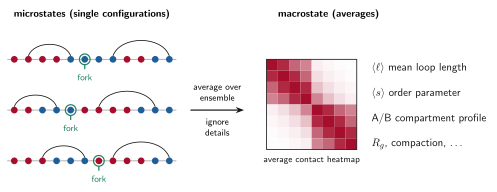
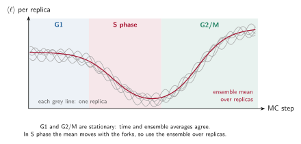

# Microstates, macrostates and ensembles

Statistical physics separates the **detailed description** of a system from the **averaged description** that we actually compare with experiments. This page explains the vocabulary and how it maps onto RepliSage.

## Microstate

A **microstate** is a complete specification of the system at one instant. In RepliSage, a microstate is the configuration

$$\mathcal{S} = \left(\{(m_i, n_i)\}_{i=1}^{N_{\text{lef}}},\ \{s_k\}_{k=1}^{N_{\text{beads}}}\right)$$

together with the state of replication $f_{\text{rep}}(x,t)$ at that time: **where every LEF leg sits, which state each bead has, and where every fork is**. In the 3D part, the exact coordinates of the beads belong here too. There are astronomically many microstates, and each single one is of little use on its own, since a real cell population is a mixture of them.

## Macrostate

A **macrostate** is a description by a few averaged quantities that many microstates share. The paper uses exactly this language: compartmentalisation is a macrostate that emerges from the microstates (the individual epigenetic labels). Typical macrostates in RepliSage are:

* an **order parameter**, such as the mean state $\langle s \rangle$, the fraction of links that join beads of the same sign, or the mean loop length $\langle \ell \rangle$;
* the **average contact heatmap**, obtained by averaging over the ensemble;
* the **A/B compartment profile**, from the mean epigenetic state of each bead;
* structural summaries such as the radius of gyration $R_g$.

Many different microstates give the same macrostate. For example, two different arrangements of LEFs can have the same mean loop length.

Beads are coloured by their state $s_k$ (red for $s_k>0$, blue for $s_k<0$), arcs are LEFs $(m_i, n_i)$ and the green ring marks the bead where a replication fork sits.

## Ensembles

An **ensemble** is the collection of microstates we sample, here the MCMC samples from all replicas. A macrostate is an average over the ensemble, $\langle O \rangle$, as in [Monte Carlo, MCMC and Metropolis](mcmc.md). This is why RepliSage produces many structures per phase rather than one: the experiment (for example Hi-C) is itself an average over many cells.

| Concept | In RepliSage | Example |
|---|---|---|
| Microstate | One sampled configuration | positions of LEFs, epigenetic states, forks, bead coordinates |
| Observable $O(\mathcal{S})$ | A function of a microstate | loop length of this configuration |
| Ensemble | All samples from all replicas | thousands of structures |
| Macrostate | Average of observables | $\langle \ell\rangle$, $\langle s\rangle$, the average heatmap |

## Equilibrium and S phase

In **G1 and G2/M** the rules do not change, so the ensemble is stationary and macrostates settle to constant values. In **S phase** the forks keep changing the rules, so the macrostates move with time: the mean loop length drops, and the average epigenetic state shifts as forks pass. The relevant averaging is over **replicas at each time**, not over time.

This is the main reason why RepliSage reports phase-wise means and uses several replicas (`--n-replicas`): see [Analysis](analysis.md) for how the report computes them, and [Known limitations](limitations.md) for what this does not capture.
