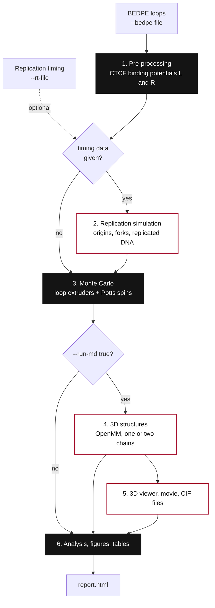
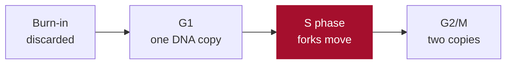

# Pipeline

RepliSage is a chain of small stages. Each stage reads what the previous one produced, and the inputs you give decide which stages run. Every stage can also be run on its own from a script (see the bottom of each file in `src/pipeline/`).



Black boxes always run; red-outlined boxes run only when their inputs are present.

## The stages

| # | Stage | Needs | Produces | Page |
|---|---|---|---|---|
| 1 | Pre-processing | BEDPE, region, beads | Binding potentials of left and right CTCF sites per bead | [preproc.md](preproc.md) |
| 2 | Replication simulation | Timing data | Matrix saying which bead is replicated at each time, fork positions, initiation rate | [replication_model.md](replication_model.md) |
| 3 | Monte Carlo | Stages 1 and 2 | Loop positions, epigenetic spins and energies over time, for each replica | [mc_model.md](mc_model.md) |
| 4 | 3D structures | Stage 3 | One CIF file per sampled state | [md_model.md](md_model.md) |
| 5 | 3D visualisation | Stage 4 | Interactive viewer, movie, ChimeraX script | [visualization.md](visualization.md) |
| 6 | Analysis | Stage 3 (and 4) | Statistics, MCMC diagnostics, figures, `report.html` | [analysis.md](analysis.md) |

## Time in a replicating run

For what each phase means biologically, see [Scope and goals](scope.md).

A cell cycle is laid out along the Monte Carlo steps. The first steps are burn-in, during which the system relaxes. G1 follows, then S phase from `REP_START_TIME` for `REP_TIME_DURATION` steps, then G2/M.



During S the replicated-DNA matrix tells the Monte Carlo which beads are already copied. The 3D model then has two chains (the sister chromatids) that are tied together where DNA is replicated and pulled apart after S.

## Replicas

`--n-replicas N` repeats the Monte Carlo with different random numbers. Every replica gets its own sub-folder (`replica_00`, `replica_01`, ...) with a full report, and the run folder gets a summary report that compares them with a between-replica convergence check.

## Run folder layout

```text
results/<run_name>/
├── report.html              summary report (when there are several replicas)
├── config_used.ini          exact parameters of the run
└── replica_00/
    ├── report.html          start here
    ├── viewer_3d.html       interactive 3D viewer
    ├── movie_3d.mp4/.gif    interpolated movie
    ├── ensemble/*.cif       one 3D structure per sampled state, view.cxc for ChimeraX
    ├── plots/               figures (png and svg)
    └── metadata/            arrays (npy) and statistics (csv)
```

With a single replica the files sit directly in the run folder.

## In the code

| Function or class | What it does |
|---|---|
| `run_pipeline(args, command)  (`pipeline/orchestrator.py`)` | runs the stages below in order |
| `build_context(args, make_dirs)  (`pipeline/context.py`)` | `RunContext`: which stages run, folders, region |
| `run_preprocessing(ctx)` | stage 1 |
| `run_replication(ctx)` | stage 2 |
| `run_mc_stage(ctx, L, R, n_ctcf, rep)` | stage 3 |
| `run_md_stage(ctx, p, res, out_dir, rep)` | stage 4 |
| `run_viz3d(ctx, p, res, out_dir, rep)` | stage 5 |
| `run_analysis(ctx, p, res, out_dir, rep, command)` | stage 6, includes `make_figures` and `write_report` |
